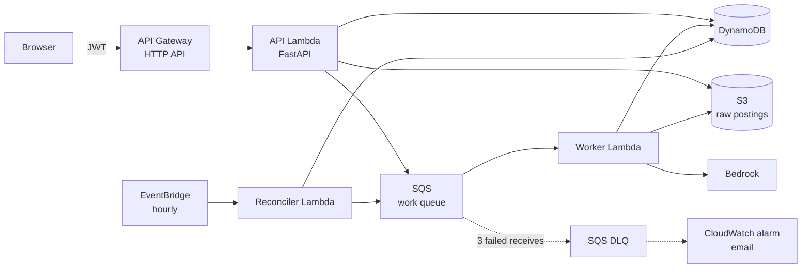

# Job Posting Triage Agent

An authenticated, asynchronous service that turns job postings into structured
requirements and an explicit list of skill gaps against a stored profile, with
measured extraction accuracy.

Built on AWS: a FastAPI service and a queue worker running as Lambda container
images, SQS, DynamoDB, S3, Bedrock and Cognito. Infrastructure is Terraform,
deployed by GitHub Actions over OIDC with no stored AWS keys.

**Status:** the deployment pipeline and a walking skeleton are in place (see
[Roadmap](#roadmap)). Features land one commit at a time, each through CI.

## Architecture



Built so far: API Gateway, both Lambdas, the queue, the dead-letter queue and
its alarm. The rest is designed and arrives per the roadmap.

## Design decisions

- **The API never calls the model.** It validates, records, enqueues, and
  returns `202`. Every request stays far below API Gateway's 30-second limit,
  and all model work becomes retryable.
- **One message per posting, with a dead-letter queue.** A bad posting fails
  alone. After three receives it lands in the DLQ and an alarm sends an email;
  failed work is never silently dropped.
- **Messages carry IDs, never content.** Posting text lives in S3, so there is
  exactly one copy to trust.
- **No stored cloud credentials.** GitHub Actions assumes AWS roles through
  OIDC. Only `main` can assume the deploy role; pull requests get a read-only
  plan role.
- **The pipeline cannot escalate its own privileges.** Every role the deploy
  role creates must carry a permissions boundary, so a compromised workflow
  cannot mint an admin role.
- **Deploys are provable.** Images are built once, scanned, and deployed by
  digest. The smoke test passes only when `/health` reports the commit that
  was just shipped.
- **Cost has fuses.** Lambda only, no always-on compute; worker concurrency is
  capped at the queue; a monthly budget alert covers the whole account.

## Roadmap

- [x] Walking skeleton: CI/CD, infrastructure, `/health`, queue worker, DLQ alarm
- [x] Data layer: DynamoDB table, S3 bucket, posting store with conditional writes
- [ ] Auth: Cognito user pool, JWT validation at the gateway and in the app
- [ ] Ingest: submit and list postings, per-user daily quota
- [ ] Worker pipeline: lease-based state machine, resume from last good stage
- [ ] Extraction: Bedrock structured output, schema validation, guardrails
- [ ] Evaluation: hand-labeled golden set, precision/recall, cost per posting
- [ ] Gap analysis against a stored profile
- [ ] Reconciler for stuck work, documented failure drills
- [ ] React frontend on CloudFront
- [ ] Greenhouse job-board source

## Run locally

Requires Docker and [uv](https://docs.astral.sh/uv/).

```bash
cd backend
uv sync --locked
uv run ruff check . && uv run pyright && uv run pytest
cd ..
docker compose up --build
```

Then, in another terminal:

```bash
curl localhost:8080/health
cd backend && uv run python scripts/send_test_message.py
```

The `worker` container logs `received work message`.

## Deploy

[`docs/setup.md`](docs/setup.md) goes from a clean clone to a deployed stack.

## Repository layout

```
backend/            FastAPI app, worker, tests, Dockerfile (targets: api, worker)
infra/bootstrap/    state bucket, ECR, OIDC roles, permissions boundary (applied once, by hand)
infra/main/         everything else (applied by CI)
local/              ElasticMQ config for Docker Compose
docs/setup.md       deploy guide
.github/workflows/  ci.yml (every PR), deploy.yml (push to main)
```